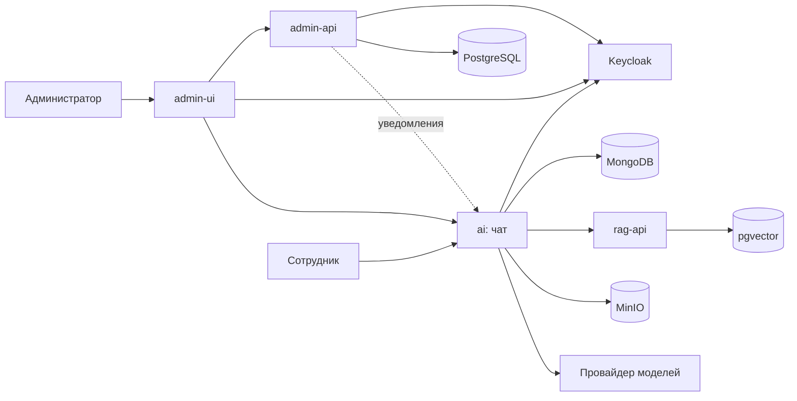

# Corporate — корпоративный ИИ-ассистент с RAG

НИРС, МГТУ им. Н. Э. Баумана, группа ИУ5-52Б.

Corporate — чат-ассистент для сотрудников компании. Он отвечает на вопросы по внутренней базе знаний (регламенты, инструкции, договоры, тарифы) и ссылается на документы, из которых взят ответ. К ассистенту прилагается админ-панель: в ней ведут сотрудников и отделы, наполняют базу знаний, задают лимиты и смотрят расходы.

## Цель

Сократить время, которое сотрудник тратит на поиск ответа во внутренних документах, и дать компании контроль над тем, какие данные и модели использует ИИ, кто и сколько на него тратит.

Задачи проекта:

- поиск по базе знаний с генерацией ответа (RAG) и ссылками на источники;
- разграничение доступа к базе знаний по отделам;
- единый вход сотрудников через Keycloak;
- защита от отправки в модель персональных данных и секретов (DLP);
- учёт расходов и лимиты на сотрудника и отдел;
- админ-панель для управления всем перечисленным.

## Пользователи и роли

| Роль | Кто это | Что может |
|---|---|---|
| Сотрудник (`USER`) | любой работник компании | чат, поиск по разделам базы знаний, открытым его отделу, свои проекты и документы, память, заявка на повышение лимита; в админ-панель не входит |
| Руководитель отдела (`HEAD`) | глава отдела | всё, что сотрудник, плюс в админ-панели в пределах своего отдела: настройки сотрудников, расходы, заявки на лимит, разделы и документы базы знаний |
| Администратор (`ADMIN`) | ответственный за систему | вся админ-панель: сотрудники и отделы, настройки ИИ для сотрудников и отделов, база знаний, промпты, расходы, аналитика, обратная связь, память |
| Владелец (`OWNER`) | первый администратор | права администратора; только владелец может назначить другого владельца |

Подробная матрица прав — в [спецификации](docs/specification.md#пользователи-и-роли).

## Возможности

- **Чат** с моделями через OpenAI-совместимого провайдера; администратор задаёт, какие модели доступны.
- **База знаний.** Документы разбиты на разделы с доступом по отделам. Документы индексируются в pgvector, ответ сопровождается карточками источников.
- **Проекты** — беседы группируются в проекты, к проекту сотрудник прикладывает свои документы, видимые только ему.
- **DLP** — маскирование персональных данных и ключей до отправки запроса в модель.
- **Лимиты и расходы** — суточный лимит в долларах на сотрудника и отдел, журнал стоимости каждого вызова модели, заявки на увеличение лимита.
- **Память** — факты о сотруднике, которые ассистент учитывает в следующих разговорах.
- **Генерация изображений** с обязательным подтверждением сотрудником.
- **Веб-поиск**, **голосовой ввод** и **экспорт ответа в файл** (Word, PDF, Excel, CSV, PowerPoint, Markdown).
- **Админ-панель** с разделами «Сотрудники», «Отделы», «Настройки сотрудников», «Настройки отделов», «Заявки на лимиты», «Промпты», «База знаний», «Расходы», «Аналитика», «Обратная связь», «Память».

## Архитектура



Компоненты, потоки данных и развёртывание описаны в [docs/architecture.md](docs/architecture.md).

## Структура репозитория

| Каталог | Что внутри | Стек |
|---|---|---|
| [`ai/`](ai/README.md) | чат-ассистент: веб-интерфейс, сервер, RAG, база знаний, серверная часть админки | TypeScript, React, Node.js, Express, MongoDB |
| [`admin-ui/`](admin-ui/README.md) | админ-панель | TypeScript, React, Vite, TanStack Query |
| [`admin-api/`](admin-api/README.md) | сервис сотрудников и отделов, синхронизация с Keycloak | Go, PostgreSQL |
| [`deploy/`](deploy/README.md) | развёртывание всего стенда в Kubernetes | Kustomize |
| [`docs/`](docs/) | спецификация и архитектура | |

## Запуск

Каждая часть запускается из своего каталога; команды и переменные окружения — в README частей.

```bash
cd ai && npm ci && npm run build:packages && npm run backend:dev
cd admin-ui && npm ci && npm run dev
cd admin-api && go run ./cmd/admin-api serve
```

Полный стенд (MongoDB, pgvector, rag-api, Keycloak, MinIO, локальные эмбеддинги) разворачивается в Kubernetes одной командой `kubectl apply -k deploy` — пошагово в [deploy/README.md](deploy/README.md).

## Команда

- Щепнов Филипп Владимирович
- Купрюшин Егор Андреевич
- Воронков Александр Дмитриевич

## Лицензии

Чат-ассистент в `ai/` основан на [LibreChat](https://github.com/danny-avila/LibreChat) и распространяется по лицензии MIT (`ai/LICENSE`).
