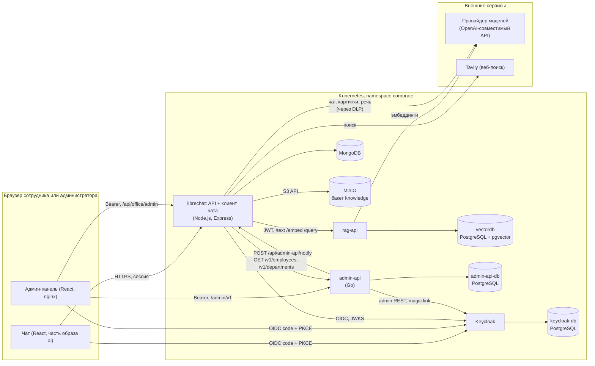
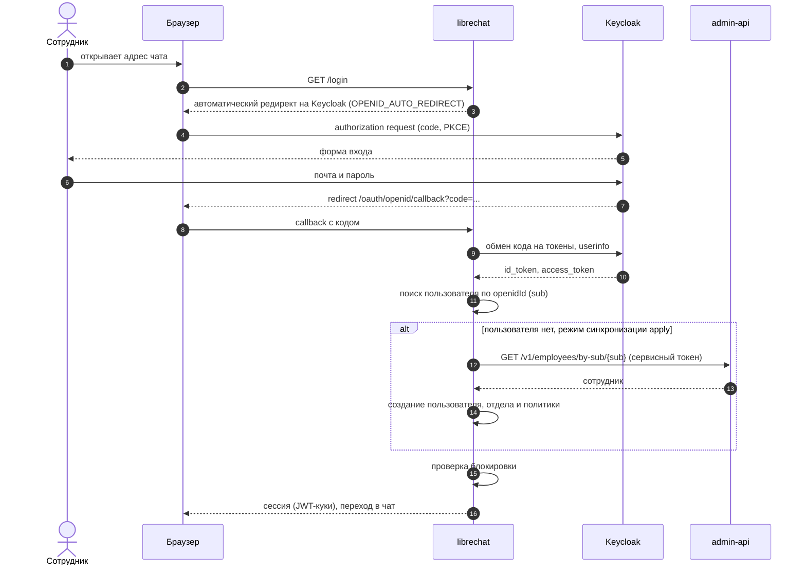
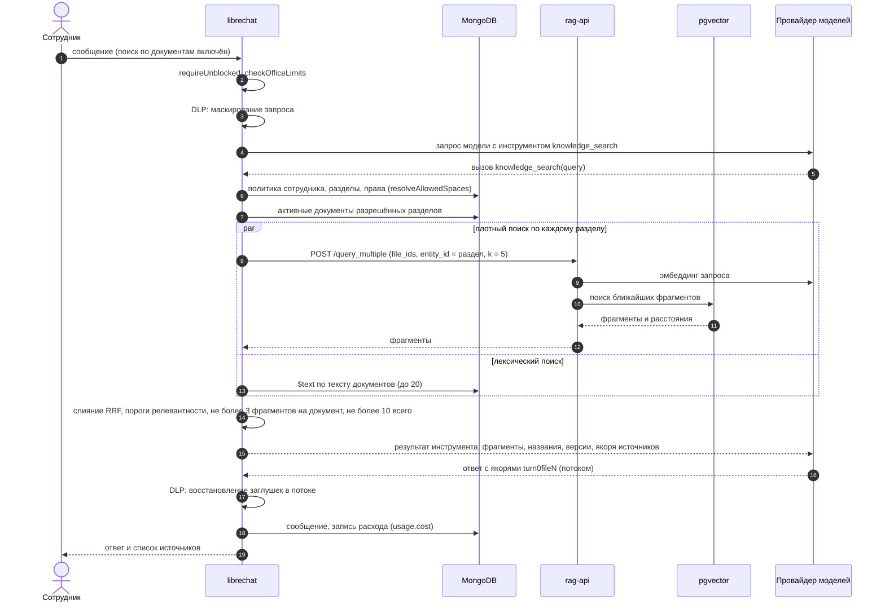
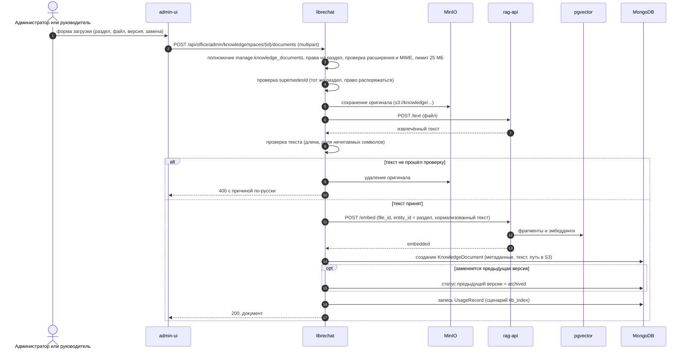
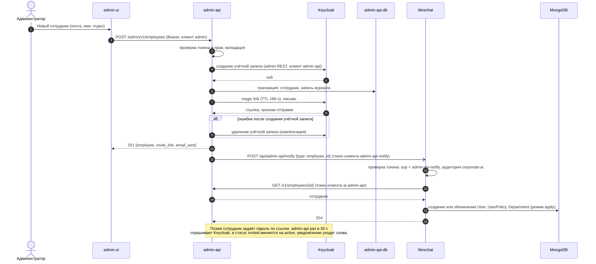

# Архитектура системы Corporate

Документ описывает устройство системы по коду репозитория. Что система делает и для кого: [specification.md](specification.md). Реализационные спецификации по компонентам (контракты API, модель данных по полям, экраны админ-панели, алгоритмы, развёртывание) — в каталоге [specs/](specs/README.md).

Каталог `ai/` основан на LibreChat (лицензия MIT); корпоративные доработки сосредоточены в `packages/api/src/corporate`, `packages/api/src/admin/corporate`, `packages/api/src/directory`, `packages/api/src/dlp`, `api/server/routes/office.js`, `api/server/routes/directory.js`, `client/src/components/Knowledge`, `packages/data-schemas` (модели `corporate*`, `knowledge*`, `usageRecord`, `userPolicy` и другие) и `deploy/`.

## 1. Компоненты

| Компонент | Что запускает | Ответственность |
|---|---|---|
| Сервер и чат (`librechat`) | Образ `ai/` (Node.js, Express, React): API и веб-клиент в одном процессе, порт 3080 | Вход через OIDC, чат и вызовы моделей, инструменты (поиск по базе знаний, веб-поиск, картинки, экспорт файлов), RAG-оркестрация, DLP, лимиты и журнал расходов, память, проекты, админ-API `/api/office/*`, приём уведомлений справочника `/api/admin-api/notify`, периодическая синхронизация справочника |
| Админ-панель (`adminui`) | Статика `admin-ui/` за nginx, порт 80 | Интерфейс администратора и руководителей. Сама данных не хранит: ходит в сервер ассистента и в `admin-api` с токеном Keycloak пользователя |
| Сервис сотрудников (`admin-api`) | Go-сервис, порт 8091 | Справочник сотрудников и отделов, приглашения, фото, журнал действий, зеркалирование учётных записей в Keycloak, уведомления серверу ассистента, самолечение зеркала |
| Keycloak | `quay.io/keycloak/keycloak` 26.7.2 с темой `corporate` и расширением magic link | Единый вход, учётные записи и пароли, сессии, письма-приглашения |
| `rag-api` | Образ `librechat-rag-api-dev-lite`, порт 8000 | Извлечение текста из файлов (`/text`), разбиение на фрагменты и эмбеддинги (`/embed`), векторный поиск (`/query`, `/query_multiple`), удаление (`/documents`) |
| `vectordb` | PostgreSQL с pgvector | Векторный индекс фрагментов документов (база `ragdb`) |
| MongoDB | `mongo` 8.0 | Основное хранилище сервера ассистента |
| MinIO | S3-совместимое хранилище | Оригиналы документов базы знаний (бакет `knowledge`) |
| `admin-api-db` | PostgreSQL 16 | Данные `admin-api` |
| `keycloak-db` | PostgreSQL 16 | Данные Keycloak |
| Провайдер моделей | Внешний OpenAI-совместимый API (OpenRouter или второй провайдер, переключается `AI_PROVIDER`) | Чат-модели, эмбеддинги, распознавание речи, генерация картинок |
| Tavily | Внешний сервис | Веб-поиск и чтение страниц |

### 1.1. Диаграмма компонентов

### 1.2. Структура сервера ассистента

| Слой | Расположение | Назначение |
|---|---|---|
| Маршруты | `ai/api/server/routes/office.js` | Три роутера: `admin` (`/api/office/admin`), `usage` (`/api/office/usage`), `knowledge` (`/api/office/knowledge`) |
| Маршруты справочника | `ai/api/server/routes/directory.js` | Приём уведомлений от `admin-api` |
| Админские обработчики | `ai/packages/api/src/admin/corporate` | Сотрудники, отделы, настройки, заявки на лимит, расходы, аналитика, обратная связь, база знаний, модели, полномочия вызывающего |
| Предметная логика | `ai/packages/api/src/corporate` | Политика (лимиты, модели, промпт), доступ и поиск по базе знаний, документы проектов, картинки, экспорт файлов, голос, память, реестр провайдеров |
| DLP | `ai/packages/api/src/dlp` | Детекторы, таблица заглушек, обёртка над `fetch` к провайдеру, аудит |
| Справочник | `ai/packages/api/src/directory` | Клиент `admin-api`, синхронизация сотрудников и отделов |
| Данные | `ai/packages/data-schemas` | Схемы Mongoose и методы доступа |
| Клиент | `ai/client/src/components/Knowledge` и другие | Интерфейс чата, раздел базы знаний для сотрудников |
| Конфигурация | `librechat.yaml` (в `ConfigMap`), переменные `ConfigMap` | Модели, DLP, память, инструменты, провайдер |

Админ-маршруты сервера защищены цепочкой: `requireAdminToken` (токен Keycloak клиента `admin` с аудиторией `corporate-ai`, пользователь ищется по `sub`; при режиме `apply` отсутствующий сотрудник создаётся из справочника по требованию) затем `requireAdminAccess` (полномочие `access:admin`), затем полномочие раздела и ограничение по отделу в обработчике.

Каждый запрос чата проходит проверки `requireUnblocked` (блокировка) и `checkOfficeLimits` (суточный лимит, допустимость модели).

## 2. Основные потоки

### 2.1. Вход через Keycloak

Чат использует серверный OIDC-поток LibreChat (клиент `librechat`, PKCE), админ-панель делает код-обмен в браузере (клиент `admin`, PKCE) и хранит токены с обновлением по refresh-токену.

Для админ-панели последовательность отличается шагами 7 и далее: браузер сам обменивает код на токены у Keycloak и вызывает `admin-api` (`/admin/v1/me`) и `librechat` (`/api/office/admin/me/capabilities`) с заголовком `Authorization: Bearer`. Оба сервиса проверяют подпись по JWKS Keycloak, клиент (`azp = admin`) и аудиторию (`admin-api` и `corporate-ai`). Панель открывается, если справочник вернул `is_admin`, либо сервер ассистента вернул полномочие `access:admin`.

### 2.2. Вопрос к базе знаний

Правила цитирования добавляются в системную часть контекста; в режиме обязательного поиска модель обязана сказать, что информации нет, если поиск ничего не вернул.

### 2.3. Загрузка документа в базу знаний

При сбое извлечения или индексации оригинал удаляется, запись в MongoDB не создаётся: документа без индекса в базе быть не должно. Сотрудник с правом загрузки идёт через `/api/office/knowledge/spaces/{id}/documents`, тот же конвейер `ingestDocument`, но с проверкой прав на запись в раздел. Удаление документа убирает вектора из `rag-api` и оригинал из хранилища.

### 2.4. Управление сотрудником: админ-панель, admin-api, Keycloak, уведомление ассистента

Блокировка сотрудника (`PATCH` с `blocked: true`) идёт по тому же пути, дополнительно `admin-api` завершает сессии в Keycloak, а сервер ассистента при синхронизации удаляет сессии пользователя и сбрасывает кэш блокировки. Если уведомление не дошло, сервер ассистента всё равно подхватит изменение: раз в минуту он читает полный список сотрудников и отделов (`startDirectorySync`), а `admin-api` раз в 5 минут сверяет профили в Keycloak со справочником.

## 3. Модель данных

### 3.1. MongoDB (сервер ассистента)

Корпоративные модели, добавленные к схемам LibreChat:

| Модель | Назначение | Ключевые поля |
|---|---|---|
| `UserPolicy` | Политика сотрудника | `userId` (уникален), `departmentId`, `limits` (личный лимит или `null`), `allowedModels`, `defaultModel`, `blocked`, `allowedSpaces`, `deniedSpaces`, `canUploadKnowledge` |
| `Department` | Отдел (зеркало справочника) | `name` (уникально), `description`, `systemPrompt`, `allowedModels`, `defaultModel`, `defaultLimits`, `directoryId` |
| `CorporateSettings` | Глобальные настройки (одна запись `key = global`) | `systemPrompt`, `allowedModels`, `defaultModel`, `defaultLimits`, `modelCapabilities` |
| `KnowledgeSpace` | Раздел базы знаний | `name`, `description`, `allowedDepartments`, `embeddingModel`, `enabled` |
| `KnowledgeDocument` | Документ раздела | `spaceId`, `file_id`, `title`, `version`, `effectiveDate`, `status` (`active`, `draft`, `archived`), `supersedesId`, `storagePath`, `text`, `embedded`, `uploadedBy` |
| `UsageRecord` | Журнал расходов | `userId`, `departmentId`, `model`, `conversationId`, `messageId`, токены, `costUsd`, `costSource`, `scenario`, `imagePrompt`, `imageFileId` |
| `LimitRequest` | Заявка на повышение лимита | `userId`, `window` (`daily`), `comment`, `limitBefore`, `limitAfter`, `status`, `resolvedBy` |
| `ChatProject` | Проект сотрудника | `name`, `description`, `user`, `conversationCount` |
| `ProjectDocument` | Документ проекта | `owner`, `projectId`, `file_id`, `text`, `tokenCount`, `embedded`, `status` |
| `MemoryEntry`, `MemorySnapshot` | Память и снимки до сжатия | снимок: `entries`, `reason`, `before`, `after`; срок жизни 30 суток (TTL-индекс) |
| `SystemGrant`, `Role` | Полномочия ролей | `principalId` (`OWNER`, `ADMIN`, `HEAD`, `USER`), `capability` |
| `AuditLog` | Аудит, в том числе срабатывания DLP | `category`, `action`, `severity`, `actor`, `target`, `metadata` |

Расширения модели `User` LibreChat: `employeeId` (идентификатор в справочнике), `position`, `openidId` (`sub`), `role`. Беседы, сообщения, файлы, оценки ответов хранятся в штатных коллекциях LibreChat.

Уникальные и составные индексы: `KnowledgeDocument.file_id`, `UsageRecord (userId, createdAt)`, `(departmentId, createdAt)`, `(model, createdAt)`, `LimitRequest` частичный уникальный по `(userId, window)` для статуса `pending` (одна открытая заявка), текстовый индекс по тексту документов для лексического поиска.

### 3.2. PostgreSQL `admin-api`

| Таблица | Назначение |
|---|---|
| `departments` | `id`, `name` (уникально среди неудалённых), `description`, `created_at`, `updated_at`, `deleted_at` |
| `employees` | `id`, `keycloak_sub`, `email`, `first_name`, `last_name`, `position`, `department_id`, `is_admin`, `is_head`, `blocked`, `invited_at`, `invite_expires_at`, `invited_by`, `activated_at`, `name_confirmed_at`, `avatar_version`, метки времени, `deleted_at` |
| `employee_avatars` | `employee_id`, `content` (JPEG), `updated_at` |
| `audit_log` | `id`, `at`, `actor_id`, `action`, `target_type`, `target_id`, `details` (jsonb) |

Миграции выполняет команда `admin-api migrate` (goose), в кластере она запускается init-контейнером.

### 3.3. PostgreSQL `vectordb`

Схему создаёт и ведёт `rag-api`: фрагменты документов с эмбеддингами и метаданными (`file_id`, страница) и привязкой к сущности (`entity_id`: идентификатор раздела базы знаний или проекта).

## 4. Технологии

| Область | Технологии |
|---|---|
| Сервер ассистента | Node.js 24, Express 5, Mongoose 8, TypeScript, монорепозиторий пакетов (`api`, `packages/api`, `packages/data-schemas`, `packages/data-provider`) |
| Клиент чата | React 18, TypeScript, Vite |
| Админ-панель | React, TypeScript, Vite, TanStack Query, Tailwind CSS, Jest и Testing Library; раздача nginx |
| Сервис сотрудников | Go 1.26, `pgx`, `goose`, `go-jose` (проверка JWT), `imaging` (обработка фото), тесты на `testcontainers` |
| Единый вход | Keycloak 26.7.2, OIDC, расширение magic link, своя тема входа и писем |
| Хранилища | MongoDB 8.0, PostgreSQL 16 (Keycloak и `admin-api`), PostgreSQL 15 с pgvector 0.8 (индекс), MinIO |
| RAG | `rag-api` (LibreChat RAG API, вариант lite), эмбеддинги `baai/bge-m3` через OpenAI-совместимый провайдер, гибридный поиск (pgvector и текстовый индекс MongoDB) со слиянием RRF |
| Модели | Через OpenAI-совместимый провайдер (OpenRouter либо второй, `AI_PROVIDER`): GPT-5.6 Luna, Gemini 3.7 Flash, Claude Sonnet 5, генерация картинок, распознавание речи |
| Веб-поиск | Tavily |
| Развёртывание | Kubernetes, Kustomize, ingress-nginx, cert-manager, образы собираются Dockerfile |
| Часовой пояс | `Europe/Moscow` для границы суток в лимитах |

## 5. Развёртывание

Все объекты находятся в пространстве имён `corporate`. Манифесты пронумерованы в порядке применения.

### 5.1. Манифесты `ai/deploy`

| Файл | Что запускает | Хранилище и ресурсы |
|---|---|---|
| `00-namespace.yaml` | Пространство имён `corporate` | |
| `10-config.yaml` | `ConfigMap librechat-env` (переменные окружения) и `librechat-yaml` (`librechat.yaml`: модели, DLP, память, поиск, картинки, речь) | |
| `20-mongo.yaml` | `StatefulSet mongodb` (`mongo:8.0.20`, 1 реплика), headless-сервис | PVC 5 ГиБ, лимит памяти 700 МиБ, кэш WiredTiger 0,25 ГБ |
| `30-librechat.yaml` | `Deployment librechat` (образ `ghcr.io/novip1906/corporate-ai`, 1 реплика, `RollingUpdate` без недоступности), сервис, два PVC | `librechat-data` 3 ГиБ (загрузки, логи, изображения), `knowledge-data` 10 ГиБ (оригиналы при работе без S3); память 500 МиБ запрос, 1100 МиБ лимит; пробы `/health` |
| `40-ingress.yaml` | Ingress чата, TLS через cert-manager, тело запроса до 60 МБ, таймауты 300 с | В базовую сборку не входит: в оверлее `deploy/` его заменяет `ingress.yaml` |
| `50-vectordb.yaml` | `Deployment vectordb` (`pgvector/pgvector:0.8.0-pg15`), стратегия `Recreate`, сервис | PVC 5 ГиБ, память 512 МиБ |
| `60-rag-api.yaml` | `Deployment rag-api` (`librechat-rag-api-dev-lite`), init-контейнер ждёт `vectordb`, сервис 8000 | Переменные: `VECTOR_DB_TYPE=pgvector`, `EMBEDDINGS_MODEL=baai/bge-m3`, адрес и ключ провайдера для эмбеддингов; память 700 МиБ |
| `70-keycloak-db.yaml` | `StatefulSet keycloak-db` (`postgres:16`) | PVC 2 ГиБ, память 300 МиБ |
| `71-keycloak.yaml` | `Deployment keycloak` (26.7.2, `start`), init-контейнер ждёт БД, `ConfigMap` с темами входа и писем | Память 700 МиБ; расширение magic link подключается патчем окружения через `ConfigMap keycloak-magic-link-jar` (генерируется из `keycloak/providers`) |
| `72-keycloak-ingress.yaml` | Ingress Keycloak | Вне базовой сборки |
| `80-adminui.yaml` | `Deployment adminui` (`ghcr.io/novip1906/corporate-admin-ui`), сервис 80 | Память 64 МиБ |
| `81-adminui-ingress.yaml` | Ingress админ-панели | Вне базовой сборки |
| `90-minio.yaml` | `StatefulSet minio` | PVC 5 ГиБ, память 400 МиБ |
| `kustomization.yaml` | Базовая сборка: ресурсы без ingress, генератор `ConfigMap` для jar | |
| `keycloak/` | Тема `corporate` (вход, письма) и jar расширения magic link | |

### 5.2. Манифесты `admin-api/deploy`

| Файл | Что запускает | Хранилище и ресурсы |
|---|---|---|
| `10-admin-api-db.yaml` | `StatefulSet admin-api-db` (`postgres:16`), сервис | PVC 2 ГиБ, память 256 МиБ |
| `20-admin-api.yaml` | `ConfigMap admin-api`, сервис 8091, `Deployment admin-api` (стратегия `Recreate`): init-контейнер `migrate`, контейнер `serve` | Память 384 МиБ при `GOMEMLIMIT=300MiB`; пробы `/health` |
| `kustomization.yaml` | Сборка из двух файлов выше | |

Базовая сборка `admin-api` самостоятельно не запускается: обязательные `PUBLIC_BASE_URL`, `INVITE_CLIENT_ID`, `INVITE_REDIRECT_URL`, `KEYCLOAK_ISSUER`, `KEYCLOAK_JWKS_URL`, `KEYCLOAK_ADMIN_URL`, `NOTIFY_URLS` задаются оверлеем окружения. Пример такого оверлея — корневой каталог `deploy/`, описанный ниже.

### 5.3. Оверлей `deploy/`

Собирает стенд целиком: `kubectl apply -k deploy`. Порядок развёртывания и сборка образов описаны в [deploy/README.md](../deploy/README.md).

| Файл | Назначение |
|---|---|
| `kustomization.yaml` | Подключает `ai/deploy` и `admin-api/deploy`, добавляет ресурсы и патчи ниже |
| `ingress.yaml` | Ingress для `ai.*` (чат), `admin.*` (админ-панель, `admin.*/api` — `admin-api`), `auth.*` (Keycloak); ограничение частоты для сброса пароля |
| `embeddings.yaml`, `patch-rag-api.yaml` | Локальный сервис эмбеддингов (Text Embeddings Inference, `BAAI/bge-m3`): тексты документов при индексации не покидают кластер |
| `minio-bucket.yaml` | Job, создающий бакет `knowledge` |
| `patch-keycloak.yaml` | Публичный адрес Keycloak и подключение jar magic link |
| `patch-librechat-env.yaml`, `patch-admin-api-config.yaml` | Адреса окружения, режим синхронизации справочника `apply`, адреса уведомлений и приглашений |
| `realm-corporate.json`, `import-realm.sh` | Realm `corporate`: клиенты, аудитории, роли, темы; секреты клиентов подставляются из секретов кластера |
| `make-secrets.sh`, `create-admin.sh` | Создание секретов и первого администратора |

### 5.4. Связи между сервисами внутри кластера

| От | Кому | Адрес | Аутентификация |
|---|---|---|---|
| `librechat` | `rag-api` | `http://rag-api:8000` | Короткоживущий JWT, подписанный `JWT_SECRET` |
| `rag-api` | `vectordb` | `vectordb:5432` | Пароль пользователя `raguser` |
| `librechat` | MinIO | `http://minio:9000`, бакет `knowledge` | Ключи доступа |
| `librechat` | `admin-api` | `http://admin-api:8091` (`ADMIN_API_URL`) | `client_credentials`, клиент `ai-admin-api` (должен быть в `READER_CLIENTS`) |
| `admin-api` | `librechat` | Адреса из `NOTIFY_URLS` | `client_credentials`, клиент `admin-api-notify` (аудитория `corporate-ai`) |
| `admin-api` | Keycloak | Адрес из `KEYCLOAK_ADMIN_URL` | `client_credentials`, клиент `admin-api` с ролью `manage-users` |
| `adminui` (браузер) | `librechat`, `admin-api` | Через ingress | Bearer-токен пользователя, клиент `admin` |

### 5.5. Секреты

Значения в репозитории не хранятся; названия берутся из манифестов и скрипта `deploy/make-secrets.sh`.

| Секрет | Ключи | Кем используется |
|---|---|---|
| `librechat-secrets` | `CREDS_KEY`, `CREDS_IV`, `JWT_SECRET`, `JWT_REFRESH_SECRET`, `AI_API_KEY`, `POSTGRES_PASSWORD`, `ADMIN_API_CLIENT_SECRET` | `librechat` (через `envFrom`), `vectordb` и `rag-api` (пароль базы, `JWT_SECRET`, ключ провайдера для эмбеддингов) |
| `keycloak-db` | `password` | `keycloak-db`, `keycloak` |
| `keycloak-admin` | `username`, `password` | Начальная учётная запись Keycloak |
| `minio-credentials` | `accessKey`, `secretKey` | `minio` |
| `admin-api` | `db_password`, `keycloak_admin_client_secret`, `notify_client_secret`; для резервного копирования ещё `backup_dsn` | `admin-api`, `admin-api-db` |
| Дополнительные ключи | `OPENROUTER_API_KEY`, `KNOWLEDGE_S3_ACCESS_KEY`, `KNOWLEDGE_S3_SECRET_KEY`, `HTTPS_PROXY` (и `HTTP_PROXY`), ключ Tavily (`TAVILY_API_KEY`), `OPENID_CLIENT_SECRET` | Нужны серверу ассистента; `deploy/make-secrets.sh` кладёт их в `librechat-secrets`, если они заданы в окружении (ключи MinIO генерирует сам) |
| Секреты сертификатов | `corporate-tls`, `adminui-tls` (создаёт cert-manager) | ingress, поды |

### 5.6. Переменные конфигурации сервера ассистента

Задаются в `librechat-env`:

| Группа | Переменные |
|---|---|
| Провайдер | `AI_PROVIDER`, `AI_BASE_URL`, `OPENROUTER_BASE_URL`, `RUB_PER_USD` |
| Вход | `OPENID_ISSUER`, `OPENID_CLIENT_ID`, `OPENID_USE_PKCE`, `OPENID_AUTO_REDIRECT`, `OPENID_USE_END_SESSION_ENDPOINT`, `ALLOW_EMAIL_LOGIN`, `ALLOW_REGISTRATION`, `ADMIN_OIDC_AUDIENCE`, `ADMIN_OIDC_CLIENT` |
| Справочник | `ADMIN_API_URL`, `ADMIN_API_CLIENT_ID`, `ADMIN_API_NOTIFY_CLIENT`, `ADMIN_API_NOTIFY_AUDIENCE`, `ADMIN_API_SYNC_MODE` (в поставке `report`), `ADMIN_API_SYNC_INTERVAL_MS`, `ADMIN_API_SYNC_MAX_CHANGES` |
| Хранилище базы знаний | `KNOWLEDGE_S3_ENDPOINT`, `KNOWLEDGE_S3_BUCKET`, `KNOWLEDGE_S3_REGION` |
| RAG | `RAG_API_URL` |
| Прочее | `MONGO_URI`, `TZ`, `NO_PROXY`, `NODE_OPTIONS` |

## 6. Сквозные решения

| Тема | Решение |
|---|---|
| Политика | `resolvePolicy` объединяет глобальные настройки, отдел и сотрудника: модели и модель по умолчанию наследуются сверху вниз по непустому списку, лимит у сотрудника замещает целиком, промпт собирается из глобального и промпта отдела |
| Доступ к данным отдела | `resolveDepartmentScope`: админ-уровень видит все, руководитель только свой отдел, остальные получают 403. Все обработчики обязаны вызывать эту функцию, а не сверять роль сами |
| Учёт стоимости | Стоимость снимается с ответа провайдера (`usage.cost`, либо `cost_rub` с пересчётом по курсу) и пишется в `UsageRecord` независимо от активного провайдера, чтобы беседы, начатые на прежнем, считались |
| Отказоустойчивость справочника | Двойной канал: уведомления в момент изменения и полная сверка раз в минуту; защитные пороги на массовые блокировки и снятия прав администратора |
| Отказоустойчивость входа | `admin-api` самолечит расхождения профилей Keycloak и справочника раз в 5 минут, с лимитом на число включений и выключений за проход |
| Безопасность данных в запросе к модели | Обёртка над `fetch` провайдера: маскирование, восстановление в потоке, запрет отправки при сбое DLP |
| Подтверждение действий | Механизм одобрения вызовов инструментов (`toolApproval`): для `generate_image` режим «спрашивать», остальные инструменты выполняются без подтверждения |
